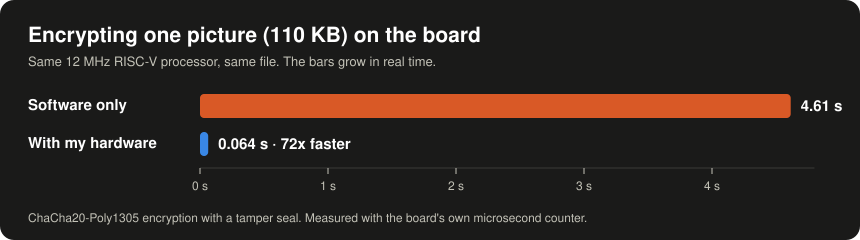

  

I build security projects that run on real hardware, and I measure what they do.

---

### WiFi Intrusion Detection System with Encrypted Cloud Alerting

It watches a Wi-Fi network for attacks and sends an encrypted alert to a phone in under
two seconds.

Passive WiFi intrusion detection running on a single ESP32. It detects
deauthentication floods, evil-twin access points, and unknown devices joining
the network, then delivers encrypted, certificate-authenticated alerts through
AWS to a live dashboard.

**[Live demo](https://wids-demo.vercel.app)**
· [Repository](https://github.com/Rayan-Shareefi/WiFi-Intrusion-Detection-System-with-Encrypted-Cloud-Alerting)

> The public demo runs on sample data. A real sensor streams to a private,
> token-protected dashboard.

### RISC-V Processor with Built-in Hardware Encryption (FPGA)

I added encryption hardware to a small RISC-V processor on an FPGA chip. It encrypts a
picture 72 times faster than the same processor can in software, and it refuses any file
that was changed, even by one byte.

  

Written in VHDL and C, tested against the official RFC 8439 test values on the board.
[Repository](https://github.com/Rayan-Shareefi/RISC-V-Hardware-Encryption-on-FPGA)
